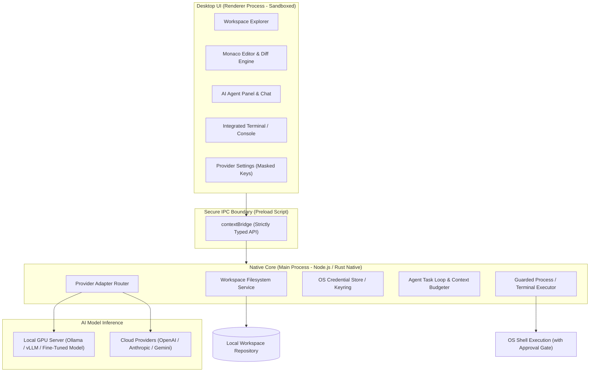

# NOXiden IDE — System Architecture Specification

**Document ID:** DOC-02  
**Status:** Implemented (Foundation Slice)  
**Last Updated:** 2026-10-30  
**References:** `docs/PRODUCT_REQUIREMENTS.md`, `docs/ARCHITECTURE_DECISIONS.md` (ADR-001)

---

## 1. System Overview & Context

NOXiden IDE is structured as a multi-process, secure desktop application. It enforces strict separation between the presentation tier (Renderer with Monaco Editor), the security-critical native core (Electron Main process with OS capabilities), and external AI model endpoints (Cloud APIs & Local GPU inference servers).



---

## 2. Process & Trust Boundaries

| Boundary | Components | Security Invariants |
|---|---|---|
| **Presentation Tier** | `src/renderer/` | `nodeIntegration: false`, `contextIsolation: true`, `sandbox: true`. Untrusted content (model responses, markdown, repository files) cannot execute arbitrary shell code or access files directly. |
| **Preload Bridge** | `src/preload/` | Exposes a frozen `window.noxiden` namespace with strictly typed async methods. No raw IPC access or `ipcRenderer.send` exposed to the DOM. |
| **Native Core Tier** | `src/main/` & `src/core/` | Has access to Node.js / OS APIs. Validates all inputs against workspace boundary restrictions. Holds API keys in memory only; never echoes secrets to logs. |
| **Model Ingress/Egress** | `src/core/providers/` | All provider requests pass through normalized adapters. Sensitive local paths are redacted or workspace-relative. Local endpoints have zero telemetry egress. |

---

## 3. Subsystem Modules

### 3.1. Desktop Window & Main Process (`src/main/`)
- Manages application lifecycle, native menus, window state, and IPC listeners.
- Enforces Content Security Policy (CSP).

### 3.2. Secure Preload Bridge (`src/preload/`)
- Exposes typed methods:
  - `workspace`: `openFolder()`, `readTree()`, `readFile()`, `writeFile()` (guarded).
  - `agent`: `sendPrompt()`, `cancelTask()`, `approveAction()`, `rejectAction()`.
  - `provider`: `getProviders()`, `saveProviderConfig()`, `testConnection()`.

### 3.3. Provider Adapter Architecture (`src/core/providers/`)
All providers implement the `ModelProviderAdapter` interface:
```typescript
export interface ModelProviderAdapter {
  id: string;
  name: string;
  isLocal: boolean;
  complete(request: CompletionRequest): Promise<CompletionResponse>;
  stream(request: CompletionRequest, onChunk: (chunk: StreamChunk) => void): Promise<CompletionResponse>;
  validateConfig(config: ProviderConfig): Promise<{ valid: boolean; error?: string }>;
}
```
Supported adapters:
- `OpenAICompatibleAdapter`: Used for OpenAI, Ollama, vLLM, llama.cpp, and custom fine-tuned Hugging Face inference endpoints.
- `AnthropicAdapter`: For Claude series models.
- `GeminiAdapter`: For Google Gemini models.

### 3.4. Agent Task Engine (`src/core/agent/`)
- Implements bounded plan-execute-observe cycles.
- Tool registry: `read_file`, `write_file`, `list_dir`, `run_terminal_command`, `git_diff`.
- Human approval gate: Any mutating action (`write_file`, `run_terminal_command`) transitions to an `AWAITING_APPROVAL` state before dispatch.

---

## 4. Local Fine-Tuned Model Integration

When the user fine-tunes a coding model (via LoRA/QLoRA on local GPU), the IDE integrates with it seamlessly via:
1. **Local Server Adapter:** Pointing to `http://localhost:11434` (Ollama), `http://localhost:8000/v1` (vLLM), or `http://localhost:8080/v1` (llama.cpp server).
2. **Hugging Face Inference Endpoint:** Secure token auth with endpoint URL for privately hosted cloud fine-tunes.
3. Zero code changes required in the IDE: the model ID and endpoint are configured in Settings and immediately active for chat, code completion, and tool execution.

